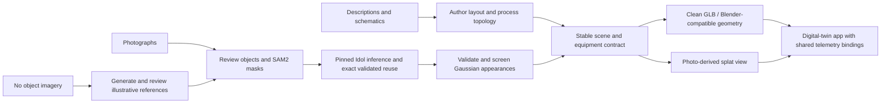

# 3D scene toolchain

Prepare **evidence-linked 3D scenes for digital-twin apps** from descriptions,
photographs and schematics. Combine clean, editable mesh geometry with
photo-derived Gaussian appearances, using one scene contract for equipment IDs,
placement, connections and provenance.

[Open the workbench](https://red-wave-0c7bb6c0f.4.azurestaticapps.net/) |
[Diamond recovery plant](https://red-wave-0c7bb6c0f.4.azurestaticapps.net/?case=D01) |
[Use both twin visual modes](docs/digital-twin-integration.md#d01-two-visual-modes-one-twin)

This repository prepares geometry and appearances. The consuming app owns
telemetry, Fabric queries, alerts and authentication. Single-image reconstruction
is not photogrammetry, measured plant geometry or engineering certification.

## The idea



Physical layout and directed connections are authored or reviewed explicitly.
A flowsheet does not establish physical placement; generated references invent
appearance, not source truth. Shared appearances reduce generation work without
merging distinct equipment identities.

## Experiments and final results

| Experiment | Result | Main lesson |
|---|---|---|
| Three description scenarios | Deterministic layouts and real Blender exports | Clean geometry is the reliable authoring and interaction baseline. |
| Eight original/generated image references | 31 validated object appearances from five sources; 203 unreviewed diagram/plan proposals from three | Photos can yield appearance; diagrams still require semantic/topology review. |
| Synthetic photographic comparisons | Baseline detection versus reviewed-box/SAM2 extraction and exact reuse | Review the target and compare receipts; supervision is not an accuracy score. |
| Three licensed real photographs | Four validated appearances; identical crop bytes with 24-89% lower CPU preparation time | Crop before full-frame RGBA allocation; savings are milliseconds, not faster Idol sampling. |
| Six illustrated prompt/schema scenes | 25 independent generations, 142 eligible authored placements after 32 exclusions | Reuse complete component concepts; screen malformed results rather than show proxy boxes. |
| D01 diamond recovery plant | 12 real generations; 10 accepted concepts across 20 visible placements | Photo-derived detail can share the clean twin's semantics; two flattened concepts remain review-only. |

Counts describe outputs and screening, not certified source fidelity. The
[experiment report](docs/trials.md) retains comparisons, settings and limitations;
[benchmark evidence](docs/benchmark-status.md) retains original execution records.

### D01: the reusable mining twin

The plant has three processing lines, **24 modules, 64 logical equipment
children, 50 directed streams and 56 telemetry tags**. Its original synthetic
photograph is 1536 by 1024. Metre dimensions, positions and routing are explicit
demo assumptions.

Two asset sets are available for a consuming app:

- **Clean model:** twelve reusable authored module GLBs plus a whole-plant GLB
  and scaled site plan. The model is Blender-compatible; D01's deterministic
  exporter is Python, not photo-recovered geometry.
- **Reconstructed model:** twelve 32,768-Gaussian component assets derived from
  the original photograph. Ten concepts pass rendered review; the flattened
  DMS tower and hopper are hidden by default and available for review.

Both must use the same IDs, layout, telemetry and selection state. The workbench
currently opens D01's reconstructed view; the GLB download remains the clean
model. A two-mode switch in the Fabric twin app is specified in the
[agent handoff](docs/digital-twin-integration.md#copyable-assignment-for-the-twin-app-agent),
not claimed as implemented here.

D01 inference completed in 2,889 seconds with a sampled peak of 9,295 MiB on a
T4. The [live publication](docs/diamond-plant.md#component-gaussian-reconstruction)
retains all prior packages and passed desktop/mobile rendering and 152 public
file-hash checks. The inference GPU was deallocated afterward.

## Recommended pipeline

Use the **supervised optimized object route** for a curated demo. It is the
best-supported path tested here, not a universal fastest or most accurate method.

1. Choose the abstraction: process modules, not every nut and bolt. Author stable
   IDs, dimensions and directed routes; distinguish assumptions from observations.
2. Use licensed/approved, sharp, unobstructed images. Review object boxes and
   resulting SAM2 masks. Where imagery is absent, generate and review separately
   labeled illustrative component references.
3. Run vision extraction and Idol in separate prepared environments. Preserve
   full model/SDK pins, 32,768 Gaussians, 50 steps, seed 42, SDPA and compile-off
   settings from the approved route.
4. Reuse only exact validated crop/settings-addressed results. Resume completed
   objects, preserve distinct placements and run GPU inference sequentially.
   Do not use category similarity as an identity/cache shortcut.
5. Validate PLYs, then inspect actual isolated and assembled renders. Apply
   covariance-aware bounds, uniform grounded fit, pinned orientation correction
   and exact-hash visual exclusions. Failed/excluded appearances are not replaced
   silently with representative boxes.
6. Package approved outputs separately, retain existing publications, and verify
   hashes and browser rendering before delivery. Stop/deallocate the inference
   worker when its dependent work is finished.

The registered D01 workflow is reproducible on an **authorized, prepared GPU
runner** with protected model access. It does not start a stopped VM or deploy
the app:

```powershell
gh workflow run gpu-batch.yml --repo ribumann/3d-scene-toolchain --ref feat/diamond-plant-splats -f smoke_mode=trials -f smoke_source=public-preview -f pilot_cases=D01 -f trial_variants=optimized -f publish_trials=true
```

As of this documentation update, that route is on
[PR #3](https://github.com/ribumann/3d-scene-toolchain/pull/3), not merged main.
The existing result is run `43294502236`; consume its approved assets instead of
rerunning inference just to build the twin app. D01 must run alone.
`publish_trials=true` approves the bounded public package, not private logs,
credentials or arbitrary source media.

See [D01 reproduction and publication](docs/diamond-plant.md#component-gaussian-reconstruction),
[trial execution/cache details](docs/trials.md#protected-sequential-workflow),
and [GPU prerequisites](infra/azure/README.md). Model and source-image licenses
are separate from the repository's MIT software license.

## Use the toolchain

### Local authoring

Requirements: Python 3.11+, a Node version allowed by `package.json`, npm,
Blender 4.x for Blender export, and WebGL2. No browser-side inference GPU is
required.

```powershell
python -m venv .venv
.\.venv\Scripts\python.exe -m pip install -e ".[test]"
npm ci
.\.venv\Scripts\scene-toolchain.exe serve
```

In another terminal, run `npm run dev -- --host 127.0.0.1` and open
`http://127.0.0.1:5173`. Select a procedural case, edit labels/transforms,
inspect evidence, and export scene JSON. Run clean procedural exports with:

```powershell
.\.venv\Scripts\scene-toolchain.exe run --cases P01 P02 P03 --stages extract blender --report .scene-data\procedural-report.json
```

The local API is unauthenticated and loopback-only by default; do not expose it
as a production service. Private inputs and runtime state belong in ignored
`.scene-data`, never public build output.

### Static demo and app integration

Use the hosted workbench to browse results, isolate objects, inspect provenance,
toggle layers/screened-out review, and download assets. There is no public
mutation API or inference service.

`npm run build:demo` uses `python3` and produces a **reference/procedural-only**
default build on the documented Linux environment. Actual splats and D01 require
explicitly selected validated packages. Publish only `apps/web/dist-demo`, never
the repository or private runtime.

| Need | Start here |
|---|---|
| Clean/reconstructed twin modes and exact asset bindings | [Digital-twin integration](docs/digital-twin-integration.md) |
| Plant sizing, connections, provenance and assets | [D01 plant contract](docs/diamond-plant.md) |
| Sensor generation and focused Fabric/app insights | [Telemetry and Fabric specification](docs/diamond-plant-demo.md) |
| Agent acceptance and existing-infrastructure guardrails | [Mining twin Definition of Done](docs/mining-twin-agent-dod.md) |
| Opt-in package build/deployment | [Static demo guide](infra/azure/static-demo.md) |
| Scene interchange and Blender authoring | [Blender guide](blender/README.md) |

## Development checks and reference

```powershell
.\.venv\Scripts\python.exe -m unittest discover -s tests -v
npm run build
npm test -- --run
```

Blender/OCR/GPU checks require their documented tools and permissions. Unit tests
and numerical PLY validation do not establish photographic accuracy.

The [historical README](README-history.md) preserves the working narrative and
earlier setup/status reports. Use it as reference, not as current availability
or deployment truth; current outcomes and recommended usage are above.
