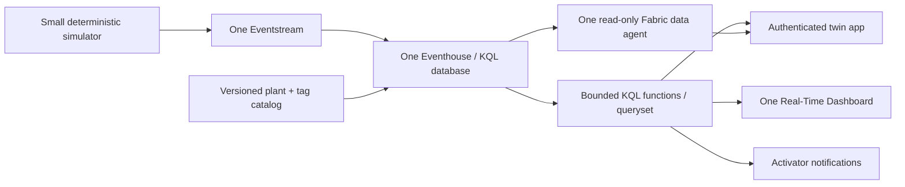

# D01: telemetry, Fabric insights and operator app specification

**App entry point:** [open the existing plant workbench](https://red-wave-0c7bb6c0f.4.azurestaticapps.net/?case=D01).
**Design goal:** explain an operational problem, locate it in the plant, show
its impact and ask a grounded question about it in a 15-20 minute demo.

This is an implementation-ready **proposal**, not a running telemetry simulator,
Fabric deployment or newly implemented app. The existing viewer is live; its
geometry, inventory and [metadata](https://red-wave-0c7bb6c0f.4.azurestaticapps.net/plant/metadata.json)
remain unchanged. In particular, the published metadata's 1,000 ms suggested
interval is an initial placeholder: use the **30/60-second profile below** when
implementing the simulator. Do not start a one-second publisher from that field.
All ranges, thresholds, production rates and faults here are fictional demo
assumptions, not manufacturer specifications or safe operating limits.

## 1. Small, coherent telemetry model

Keep the existing **56 numeric tags**, attached to the existing 24 modules and
64 logical equipment children. Do not invent a sensor for every mesh or every
internal component. Logical equipment without a listed tag inherits module
context; it must not display fabricated measurements.

Line tag IDs follow `D01.{A|B|C}.{module}.{metric}`. Shared IDs follow
`D01.shared.{module}.{metric}`. For example,
`D01.B.dms.medium_density` belongs to `D01.B.dms.density-meter`.
Use the existing metadata's `equipment_id` and `unit`, not labels, for joins.
`Cel` means degrees Celsius; `m3/h` means cubic metres per hour.

The normal bands below describe **running, settled operation**. Startup, idle,
stopped operation and scripted faults legitimately leave them. The wider
envelopes are existing simulation sanity bounds, not alert thresholds.

### Per-line sensors: these 15 definitions apply to each of A, B and C

| Module | Metric | Meaning / unit | Normal running band | Envelope | Publish |
| --- | --- | --- | --- | --- | --- |
| crusher | motor_current | Crusher-drive load, A | 55-110 | 0-250 | 30 s |
| crusher | bearing_temperature | Crusher bearing housing temperature, Cel | 45-65 | 15-110 | 60 s |
| crusher | vibration_rms | Overall crusher bearing vibration velocity RMS, mm/s; not a waveform | 1.5-3.5 | 0-20 | 30 s |
| crusher | ore_flow | Dry-equivalent incoming ore mass rate, t/h | 32-48 | 0-150 | 30 s |
| scrubber | motor_current | Drum-drive load, A | 55-85 | 0-250 | 30 s |
| scrubber | water_flow | Scrubber wash-water inlet, m3/h | 45-65 | 0-300 | 30 s |
| screen | vibration_rms | Intentional screen excitation RMS, mm/s; not a bearing-health limit | 8-12 | 0-20 | 30 s |
| screen | water_flow | Screen spray-water inlet, m3/h | 10-20 | 0-300 | 30 s |
| dms | medium_density | Ferrosilicon suspension density, kg/m3 | 2850-3000 | 2000-3500 | 30 s |
| dms | feed_pressure | Cyclone feed-pump discharge pressure, kPa | 250-350 | 0-600 | 30 s |
| dms | motor_current | DMS feed-pump load, A | 40-70 | 0-250 | 30 s |
| medium | motor_current | Magnetic medium-recovery separator drive load, A | 25-45 | 0-250 | 30 s |
| medium | level | Medium-recovery sump inventory, % usable level | 35-65 | 0-100 | 60 s |
| sorter | ore_flow | Concentrate arriving at sorter, t/h; NOT the full ore feed | 1-3 | 0-150 | 30 s |
| sorter | motor_current | Sorter feed-belt drive load, A; not X-ray tube current | 7-15 | 0-250 | 30 s |

### Shared services: eleven further tags

| Module | Metric | Meaning / unit | Normal running band | Envelope | Publish |
| --- | --- | --- | --- | --- | --- |
| hopper | level | Raw-feed inventory, % usable level | 45-70 | 0-100 | 60 s |
| hopper | ore_flow | Total ore distributed to all three lines, t/h | 110-130 | 0-150 | 30 s |
| thickener | level | Thickener operating slurry inventory, % usable level; not bed mass | 40-65 | 0-100 | 60 s |
| thickener | motor_current | Rake-drive load, A | 20-35 | 0-250 | 30 s |
| thickener | water_flow | Recovered overflow water returned to process-water tank, m3/h | 130-180 | 0-300 | 30 s |
| water | level | Process-water tank inventory, % usable level | 55-75 | 0-100 | 60 s |
| water | water_flow | Total process-water supply to washing/rinsing, m3/h | 195-270 | 0-300 | 30 s |
| lab | product_mass | Cumulative accepted-product scale mass for THIS simulator run, g | Staircase, normally 0-5 in a short session | 0-1000 | 60 s |
| control | power | Whole-plant active electrical power at one incomer, kW | 180-260 | 0-500 | 30 s |
| tailings | level | Tailings handling inventory / occupied storage, % of demo capacity | 20-55 | 0-100 | 60 s |
| tailings | water_flow | Tailings sump discharge-water rate, m3/h; not tailings solids flow | 20-45 | 0-300 | 30 s |

Do not compare the screen's intentional vibration to crusher bearing thresholds.
Do not sum hopper feed and line feed: they measure the same incoming material
at different points. Do not sum sorter concentrate with full ore throughput.

### Cadence, representation and volume budget

Advance the internal process model every **5 s**, but emit only at the listed
intervals. Each flow, current, pressure, density and power value is the mean of
its completed 30-second window. Temperature, level and cumulative product mass
are end-of-window snapshots. Vibration is an illustrative RMS summary over the
30-second window; no high-frequency samples leave the simulator. The event
timestamp is the UTC window end, not the transmission or ingestion time.

There are **45 tags at 30 s and 11 at 60 s**: 101 numeric events/minute,
1.68/second, 145,440/day if left on. Add four state heartbeats/minute
(A/B/C plus shared services), giving **105 events/minute, 151,200/day**, before
sparse state transitions. A 20-minute demo is about 2,100 events. At an assumed
350-600 JSON bytes/event, continuous operation is roughly 53-91 MB/day of
uncompressed payload, excluding transport overhead; not a Fabric storage estimate.

Batch transport every 30 s, with stable per-tag phase offsets to avoid one large
burst; do not make a network request per value. Keep publishing at the same
cadence when stopped, with truthful zero/idle values. A missing event must not
be confused with stopped equipment. No deadband suppression in the first demo:
regular samples make completeness and duration calculations much simpler.
Default session length: 20 minutes, hard stop after 30 minutes unless explicitly
extended. Stop the sender, dashboard refresh and scheduled alert evaluations
afterward; low event volume alone does not guarantee low Fabric capacity cost.

## 2. Sensor-value generation

Generate a connected process, not 56 independent random walks. Use a fixed
scenario seed and stable tag-specific seeds (for example SHA-256 of run ID,
tag ID and seed). Never use a language runtime's process-randomized hash.
Use three nominal ore rates: A=40, B=42, C=38 t/h, total=120 t/h.
The hopper's existing 150 t/h envelope therefore still contains the plant feed.

For a continuous variable, use this conceptual update at each 5-second step:

```text
alpha = 1 - exp(-5 / response_seconds)
next_value = previous_value + alpha * (target - previous_value) + bounded_noise
```

Noise should be small (typically 0.5-2% of the normal target, zero-mean and
bounded), with a slowly varying common feed disturbance and smaller independent
sensor noise. Normal ranges are not hard clamps: otherwise faults disappear.
Constrain simulated inventories to physical capacity; separately reject and log
non-finite or out-of-envelope incoming readings rather than silently clipping
them into plausible telemetry. When capacity would be exceeded, record the
scenario/model error and stop that run.

| Signal family | Target / dynamics |
| --- | --- |
| Ore / motor load | Slowly vary each line's feed around nominal by about +/-5%, response 30 s. Let `load = feed / nominal_feed`. Crusher current target `20 + 60*load`; scrubber `20 + 45*load`; DMS pump `24 + 30*load`; medium separator `18 + 15*load`; sorter belt `5 + 5*load`. Drives ramp on startup and fall to specified idle loads before stop; do not randomly switch state. |
| Flow propagation | Shared hopper rate is the sum of line crusher feeds. Shift each line's feed through an explicit 60 s scrub/screen delay and 120 s total delay to the sorter. Sorter concentrate target is 5% of delayed feed, an authored concentration assumption, not measured diamond recovery. |
| Wash water | Scrubber target `10 + 45*load`; screen `3 + 12*load`; unmetered rinse demand `8*load` per line. Shared supply is their sum, not a fourth independent random series. At nominal load it is 234 m3/h. Supply shortages constrain all three actual delivered demands together. |
| DMS process | Density target 2920 kg/m3, response 60 s, normal noise about +/-10. Feed pressure target `200 + 100*load` kPa, response 20 s. Pump current follows both duty and a scripted restriction when present. Density drifts only through an explicit medium scenario. |
| Crusher health | Bearing temperature target `25 + 30*load` Cel, response 180 s; cool toward ambient when stopped. Vibration target `1.2 + 1.2*load` mm/s, response 20 s. A bearing scenario raises vibration first, temperature later. |
| Screen vibration | Target about 10 mm/s while running, response 10 s; approximately zero while stopped. Do not apply the crusher health model. |
| Inventories | Integrate input minus output using explicit virtual demo capacities: hopper 100 t; water tank 60 m3 of active usable storage; medium sump 20 m3/line; thickener 400 m3 slurry; tailings zone 1000 t-equivalent occupancy. Initial levels are 60/65/50/50/30%. These usable capacities are assumptions, not inferred from mesh envelopes. Use slow bounded makeup/discharge control to hold normal levels. |
| Recovered / tailings water | Thickener return follows 65% of delivered process-water supply with a 90 s delay (nominal 152 m3/h). Tailings sump water is a separate delayed 30 m3/h nominal discharge. Explicit virtual makeup and unmetered water paths close the simulator's inventory bookkeeping; the available sensors do not establish a real plant water balance. |
| Shared drive / power | Thickener current target `20 + 6*(total_feed/120)` A. Whole-plant power target `35 + 1.4*total_feed` kW (203 kW nominal), response 30 s, with a small additional load during scripted drive restriction. Do not allocate this one measured incomer reading as measured per-line energy. |
| Lab mass | Persist a monotonic cumulative counter within a run. Every five minutes of accumulated running feed, add an explicitly synthetic accepted batch of about 0.05-0.20 g, scaled by the preceding feed relative to nominal. Publish the unchanged counter between batches. Reset only with a new run ID. This is a sparse demonstration signal, not a grade model or known recovery efficiency. |

For a fully consistent inventory implementation, derive each inventory's input
and output from the same internal stream state used for downstream generation,
including delayed buffers and virtual makeup/discharge paths. Do not derive a
solid mass balance by subtracting unlike slurry, concentrate and water readings.

### Three visible stories, plus one data-quality check

Run one fault at a time; the operator can choose a scenario explicitly.
Keep all timing in real demo time, rather than silently accelerating timestamps.

| Scenario | Script | Expected insight |
| --- | --- | --- |
| B crusher bearing degradation | After 3 min normal operation, raise B crusher vibration from about 2.4 to 7 mm/s over 2 min; raise bearing temperature toward 82 Cel over the next 4 min. Reduce B feed by 25% after the warning is established; propagate that reduction downstream. Recover only on an explicit scenario reset. | Locate B crusher, see the earlier vibration warning, then observe delayed throughput impact. No claim of remaining useful life. |
| C DMS dilution | Reduce C medium-density target from 2920 to 2670 kg/m3 over 3 min, hold 4 min, then restore over 2 min. Keep feed near normal initially. | Separation conditions deteriorate despite acceptable throughput: density deviation is a quality-risk indicator, NOT an observed diamond-loss measurement. |
| Shared water restriction | Interrupt makeup and reduce recovered-water inflow to 25% of normal. With the 60 m3 active tank and initially 234 m3/h demand, inventory falls from 65% to 25% in about 7.4 min. Then ramp available supply toward 35% over 1 min, throttle feeds consistently, and hold the low-level condition for 3 min before restoring inflow. Maintain a minimum inventory using the same actual withdrawal constraint. | One shared utility affects several lines; show the common upstream dependency rather than three independent equipment failures. |
| Short communication gap | Suppress only B DMS telemetry for 3 min while its simulated process continues. Resume with new timestamps, never backfill old readings as fresh. | Module becomes unknown/stale; no false healthy zero, fabricated process stop or automatic process alarm. |

Pre-seeded history, if useful for the opening screen, must have real earlier
event timestamps and a visible "seeded simulation history" label. Keep the
scenario truth log separate from observations: the agent should infer from
measurements, not read the scripted fault name as evidence.

### Event contract and state

Retain the existing eight numeric-event fields: `timestamp`, `plant_id`,
`module_id`, `equipment_id`, `tag_id`, `value`, `unit`, `quality`.
Before implementing ingestion, define a **version 2 transport envelope** adding
`schema_version=2`, `run_id`, `event_id`, `sequence` and `interval_seconds`.
These additions are a proposed schema migration: the current strict published
JSON Schema does NOT accept them unchanged. Do not sneak them into version 1.
Deduplicate by `(run_id, event_id)`; a retry reuses its event ID.

Keep state in a separate `PlantStateEvents` table, with scope ID (A/B/C/shared),
UTC timestamp, run/event IDs, a `scheduled_running` boolean and state:
`starting`, `running`, `idle`, `stopped` or `fault`. Send on transition and a
60 s heartbeat. An explicit stop is not a
communication failure. Record operator actions/scenario truth separately.
Retain no more than one live simulator per run/plant.

## 3. Minimal Fabric design



Use an Eventstream-supported custom endpoint/protocol from the server-side
sender. No separate IoT Hub, Azure Digital Twins, Spark pipeline, warehouse,
Lakehouse copy or second messaging tier is needed for this first demo.
Import the small plant/tag catalog once, rather than repeating geometry and
definitions in telemetry messages. Keep GLBs on the existing static host.

Start with four data tables: `TelemetryRaw`, `PlantStateEvents`,
`PlantCatalog` (module/equipment/tag/stream rows, distinguished by record kind),
and `AlertTransitions` (raised/cleared, rule, scope, severity and evidence).
Add ingestion time and catalog/profile version during processing.
Quarantine malformed events through ingestion validation; retain reason and
original event ID, never fabricate a successful numeric reading.
Use query-time functions for latest state and minute summaries first; materialized
views, update policies and separate aggregate tables can wait for measured need.
Keep raw telemetry 7 days and alert transitions 30 days; no permanent raw archive
or continuously running notebook for this demo.

### Six useful outputs, not dozens of dashboard measures

| Output | Calculation / reason |
| --- | --- |
| Plant and line throughput | Mean of each line's crusher `ore_flow`, summed across A/B/C for aligned windows; show current value and 15-minute trend. Integrate completed interval means as `rate * interval_seconds / 3600` for processed tonnes. Cross-check the hopper total, but do not add it again. |
| DMS condition | Per-line density deviation from 2920 kg/m3 and minutes outside 2800-3100 while running with good data; show pressure beside density to distinguish dilution from feed disturbance. Describe separation-condition risk, never recovered-diamond percentage. |
| Crusher condition | Current bearing RMS, five-minute median and temperature trend for the selected crusher. Compare B to A/C at similar load; show sustained deviations, not an opaque "AI health %" score. |
| Water and energy intensity | Integrate shared supply to m3 and shared power to kWh; divide each by plant processed tonnes over the SAME valid, covered interval. Display m3/t and kWh/t. Call the water measure gross process-water intensity, not fresh-water consumption, because it includes recycled water. |
| Run time and output | From explicit states, running minutes / observed scheduled minutes and stopped minutes per line, with unknown time separately. Lab counter differences give accepted grams per run/time window; reset boundaries require run ID. Do not call this OEE, diamond recovery efficiency or ore grade. |
| Trust and freshness | Good/expected samples per interval, age of each latest reading and ingestion delay. Surface missing/bad values and incomplete KPI coverage before interpreting process values. |

For physical totals, use only good, deduplicated samples with their actual
completed intervals; do not carry a last rate indefinitely through gaps.
Label partial totals with coverage. For ratios, require at least 90% common
time coverage across numerator and denominator, exclude startup, and return
unknown if average plant feed is below 10 t/h. Never substitute zero for missing
or bad values. Counter deltas need both valid endpoints in the same run and
must reject unexplained negative deltas.

Use 1-minute bins for the default last-30-minute charts and 5-minute bins for
longer views, maximum 24 hours. Keep 30/60-second raw detail for the selected
module only. The latest-state query must start from the complete tag catalog
and left-join observations, so a sensor with no rows still appears as unknown.
Historical replay evaluates freshness at the selected replay time, not now.

### Five alert rules with restrained notification

These are demo advisories, not protective controls or maintenance authorization.
Evaluate process rules every minute from good, running-state samples.
Require full consecutive completed windows spanning the hold duration; reset
the hold on gaps, bad quality, startup or stop. Suppress process rules during
the first two minutes of startup. Thresholds apply only to the named sensor.

| Rule | Raise / hold | Clear / hold | Priority |
| --- | --- | --- | --- |
| Crusher bearing | Crusher RMS >4.5 mm/s for 2 min; escalate if temperature >75 Cel for 2 min too | RMS <3.8 and temperature <70 for 3 min | Warning; high when both |
| DMS condition | Density outside 2800-3100 kg/m3 OR feed pressure outside 200-400 kPa for 2 min | Density 2850-3050 AND pressure 230-370 for 3 min | Warning |
| Shared water constraint | Water-tank level <25% for 2 min | Level >35% for 3 min | High; one shared incident |
| Unplanned line stop | Explicit `stopped`/`fault` for 2 min during scheduled running; planned idle/stop excluded | Explicit `running` for 2 min | Warning |
| Telemetry stale | No valid value for `3 * publish_interval + 15 s`, or missing state heartbeat for 195 s | Two successive fresh good observations / heartbeats | Data-quality warning |

A bad-quality arrival must immediately show bad/unknown, even before a stale
timer expires. Missing data does not "clear" a process warning: retain it as
unverified until sufficient good evidence meets the clear rule.

Store one transition per `(run, rule, scope, state)` change, not one alert row
per evaluation. Group multi-line water symptoms under the shared-water incident
in the app, while preserving individual evidence. Keep acknowledgements separate
from clearing. No repeating emails for an acknowledged/unresolved condition.
Start with app alerts; enable **one** Teams/email notification route for the
demo, with raise/escalation/clear messages and at least a 10-minute reminder
cooldown. No automatic plant control.

Activator can schedule KQL-query evaluations and send notifications. Use a
stateful alert adapter or supported Activator state logic to enforce the
transition/deduplication contract: repeatedly returning the same breach row
from a queryset is NOT sufficient, because per-result alerts can repeat.
Do not assume a queryset subscription automatically writes `AlertTransitions`;
that requires a separately implemented action/adapter.

## 4. A focused digital twin app

Reuse the current scene and stable IDs; build an authenticated operational mode
alongside the read-only workbench, not another asset editor. The existing public
viewer must not acquire shared Fabric credentials or private telemetry.

### One main screen, two on-demand panels

| Area | Contents / interaction |
| --- | --- |
| Header | Plant/run, LIVE or REPLAY badge, last refresh and data-quality indicator. Four KPI cards only: throughput, running lines, process-water intensity, energy intensity. Product mass stays in the lab detail, not another headline KPI. |
| Main plant view | Existing 3D plant plus optional top view; line/shared/utility toggles retained. Status colors and icons: normal, warning, high, stopped, unknown; always include text. Default overlays show only affected modules and line totals, not 56 floating labels. Stream arrows show authored direction; width can encode measured feed only where a corresponding flow tag exists. |
| Alert rail | Top three active incidents, affected asset, duration and evidence. Selecting an alert focuses its module and opens the matching chart. A shared-water incident highlights downstream dependants but labels the link as topology/context, not proven causation. |
| Equipment drawer | Two or three relevant readings, units, normal bands, sample times, quality and 30-minute trends. Crusher: RMS + temperature + load; DMS: density + pressure; water: level + supply. Include upstream/downstream links and the exact stable equipment/tag IDs. |
| Compare view | Two charts: A/B/C feed rates, then the selected diagnostic family (DMS density or crusher vibration). One additional combined water/energy trend can be selected, not displayed simultaneously by default. |
| Ask / query panel | Suggested questions, concise evidence-backed answers and a visible "View query" / "Open in Fabric" action. Expert query inspection is opt-in. |

Refresh a consolidated latest-state payload every **30 s**, and chart/alert
payloads every **60 s**. Do not poll per mesh, tag or chart. Cache matching
requests for 15 s, pause refresh in hidden tabs and stop it in replay.
The last-30-minute, one-minute series has about 30 points per line, not tens
of thousands. Default to a last-30-minute window; offer 2 h and a bounded 24 h
expert view. Keep the original accessible object list as an alternative to 3D.

### Direct queries against Fabric

Query the Eventhouse **query URI** using the Kusto SDK or query REST endpoint,
not the Fabric item-management API and not an ingestion URI.
Use Entra sign-in, a small backend-for-frontend, and least-privilege delegated
access where available; if using a managed service identity instead, enforce
per-user application authorization and scope explicitly. No secrets in the
browser, public static host, chat prompts or URLs.

Proposed read-only query contracts (not installed functions):

| Contract | Input limits | Result |
| --- | --- | --- |
| `PlantLatest` | One plant, run and as-of UTC time | All 24 modules / 56 tags, states, latest values, quality, age, status and provenance timestamps |
| `PlantSummary` | One plant/run, 15 min default, 24 h maximum | Four headline KPIs plus coverage and source-window timestamps |
| `AssetTrend` | One module, allowlisted metric family, <=24 h, 1 or 5 min bins | At most 1000 rows of aggregated series |
| `ActiveIncidents` | One plant/run/as-of time | At most 20 active incidents with evidence and raise/clear/ack state |
| `CompareLines` | One run, one metric family, <=24 h | Three aligned line series; maximum 1000 rows |

Authorize identifiers, bind query parameters rather than concatenating KQL,
apply a 10 s server timeout, and bound result size (1000 rows / 1 MB). Return
an explicit timeout/access/query error, not empty "healthy" results.
These limits belong to this proposed app, not claimed Fabric service limits.
Initially offer saved, inspectable queries; experts can open the same query in
a KQL queryset under their own permissions. Do not expose an unrestricted KQL
execution endpoint through the public demo.

### One data agent, not an autonomous control system

Use **one Fabric data agent** grounded in the KQL database's catalog, curated
telemetry views/functions and alert evidence. The same agent can answer both
operational and analytical questions; no multi-agent orchestration is needed.
Supply definitions, units, join keys, example queries, denominator/coverage
rules and the "no recovery-efficiency inference" boundary as agent instructions.
Keep scripted scenario truth out of its data sources.

Four high-impact prompts:

- "Why is Line B processing less ore than A and C in the last 15 minutes?"
- "Which DMS line has been outside its density band, for how long?"
- "Did a shared water issue affect all three lines?"
- "Show evidence for the bearing warning and compare it with normal load."

Require answers to include the time window, affected IDs, units, supporting
numbers, coverage and a link/query for inspection. Separate observed facts from
possible explanations. Say "insufficient data" when appropriate; topology and
correlation are not proof of cause. No setpoint writes, valve commands, automatic
work orders, engineering certification or invented diamond recovery percentages.

The data agent is read-only and respects underlying user access; sharing it does
not grant database access. A native app chat integration depends on the tenant's
supported agent integration/API and permissions. If unavailable, use an
authenticated "Open data agent in Fabric" link, not a fabricated chat backend.
The core dashboard must still work when AI is unavailable.

## 5. Suggested demonstration and scope boundary

1. Open a normal plant: show three lines, 120 t/h nominal feed and the four KPIs.
2. Select B bearing degradation: watch the module warning, inspect vibration
   before temperature, then see the downstream throughput reduction.
3. Ask the agent about B versus A/C; inspect its evidence and underlying query.
4. Reset into the shared-water scenario: one utility incident explains several
   affected modules; distinguish this from independent equipment failures.
5. Briefly inject a communication gap: demonstrate unknown state rather than
   falsely reporting a process stop or normal operation.

Keep DMS dilution as an alternate story, not a fourth simultaneous incident.
The low-volume sample cannot demonstrate spectral vibration diagnostics,
predictive remaining life, certified mass balance, recovery efficiency or OEE.
Avoid adding maps, maintenance systems, real control interfaces, many dashboards,
extra data copies or model training to the first build.

Acceptance for a later implementation: all 56 tag definitions are joinable;
counts match the 101 numeric samples/minute profile; repeats are deterministic;
physical totals handle gaps and counter resets; each scripted story produces
the expected raised/cleared transition without notification spam; stale data
never appears green; and every agent answer is traceable to bounded query results.

## Sources and prerequisites

Microsoft documentation reviewed for this proposal:

- [RTI core components](https://learn.microsoft.com/fabric/real-time-intelligence/get-started-with-real-time-intelligence):
  Eventstream, Eventhouse, queryset, dashboard and Activator.
- [Kusto query REST endpoints](https://learn.microsoft.com/kusto/api/rest/?view=microsoft-fabric)
  and [application authentication](https://learn.microsoft.com/kusto/api/get-started/app-authentication-methods?view=microsoft-fabric).
- [Activator from a KQL queryset](https://learn.microsoft.com/fabric/real-time-intelligence/data-activator/activator-alert-queryset):
  scheduled evaluation, per-result notifications and the cost of always-on queries.
- [Fabric data agent concepts and limitations](https://learn.microsoft.com/fabric/data-science/concept-data-agent):
  KQL sources, governed read-only access and supported integration boundaries.

A Fabric-enabled workspace/capacity, appropriate database permissions and tenant
AI settings are prerequisites, not resources created here. Current data-agent
documentation lists paid F2+ or qualifying enabled Power BI Premium capacity;
verify the target tenant's eligibility rather than assuming a free/trial
workspace supplies every AI capability. A native dashboard and data-agent link
are enough initially; embedding and custom chat can be a later step.
